<p align="center"></p>

<p align="center">
  
  
  
  
  <br>
  
  
  
  
  
  
</p>

<p align="center">
  <b>EcoRewind forecasts what a coastal wetland would have looked like if a hurricane had never hit, then checks whether the gap between that forecast and reality is really the storm.</b><br>
  <sub>Two storms · two sites · 19 models · spatial-block validation · conformal intervals · 52 pre-registered placebo tests · a web lab that runs the networks in your browser.</sub>
</p>

<p align="center">
  <a href="#-the-answer"><b>Answer</b></a> ·
  <a href="#-the-idea"><b>Idea</b></a> ·
  <a href="#-the-data"><b>Data</b></a> ·
  <a href="#-no-leakage"><b>Validation</b></a> ·
  <a href="#-the-models"><b>Models</b></a> ·
  <a href="#-results"><b>Results</b></a> ·
  <a href="#-falsification"><b>Falsification</b></a> ·
  <a href="#-web-app"><b>Web app</b></a> ·
  <a href="#-reproduce"><b>Reproduce</b></a> ·
  <a href="#-v1--v2"><b>v1 → v2</b></a>
</p>

<br>

<p align="center">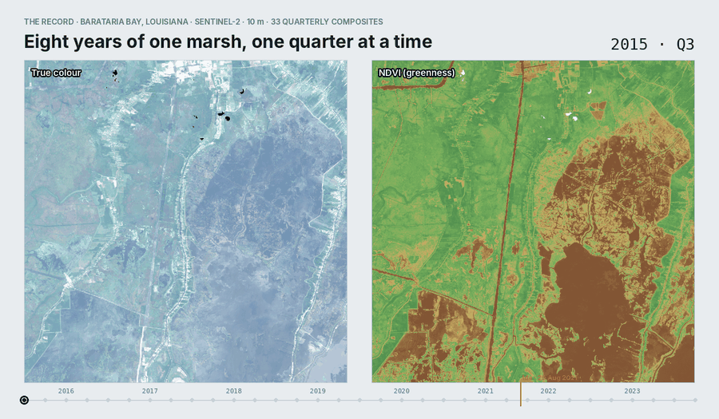</p>
<p align="center"><sub><b>Barataria Bay, Louisiana.</b> Real Sentinel-2 composites, 2015 → 2023, true colour (left) and NDVI (right). The red marker is Hurricane Ida's landfall on 29 August 2021.</sub></p>

---

## ◼ The answer

<p align="center"></p>

> [!IMPORTANT]
> **Ida caused a measurable vegetation deficit at landfall in Barataria Bay, and it did not last.** The deficit beats all 16 fake-date placebos and follows NOAA's storm track (ρ = −0.67). Once only placebo-passing models are kept, no deficit is left in quarters 1–3 (−0.005 … +0.002 NDVI).
>
> **Irma's Everglades signal cannot be attributed with this design.** It fails 14 of 16 fake-location placebos, and its damage *increases* with distance from the track. That is reported as a negative result, not hidden.

---

## ◼ The idea

<p align="center"></p>

You can't observe a world where the hurricane never happened, but you can **forecast** it. Each model sees only quarters *before* the storm and predicts every 10 m pixel for the next five quarters. The gap between that forecast and what the satellites actually saw is the **deficit**:

```
deficit(pixel, lead) = counterfactual NDVI − observed NDVI          (positive = vegetation loss)
```

A deficit is a **candidate**. It becomes an **attribution** only if all three of these hold:

| # | Check | What it rules out |
|:-:|---|---|
| 1 | **Placebo in time.** Re-run with "landfall" moved to calm years (no storm within 200 km, checked against HURDAT2). The real deficit must beat the 95th percentile of the fakes. | Models that always "see" damage |
| 2 | **Placebo in space.** Compare blocks the storm hit with inland blocks it barely touched. | Region-wide drift, sensor or cloud artefacts |
| 3 | **External evidence.** Spearman ρ between block deficit and NOAA HURDAT2 covariates. Damage should fall with distance to the track. | Signals that ignore the storm's actual path |

Every threshold above was written into [`configs/preregistration.yaml`](configs/preregistration.yaml) (hypotheses **A1–A5**) **before any model was run**.

<p align="center">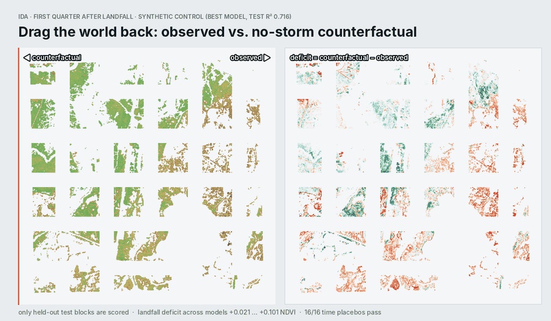</p>
<p align="center"><sub>Real output: Synthetic control's counterfactual for the first quarter after Ida, wiped against the observed NDVI, with the resulting deficit map on the right. Only held-out test blocks are scored.</sub></p>

---

## ◼ The data

<p align="center"></p>

| | Barataria Bay, LA × **Ida** | Everglades, FL × **Irma** |
|---|---|---|
| Landfall | 29 Aug 2021 · Cat 4 | 10 Sep 2017 · Cat 3 |
| Ecosystem | brackish / saline marsh | sawgrass + mangrove |
| Track A (10 m) | Sentinel-2 SR + Sentinel-1 VV/VH · 33 quarters | Sentinel-2 · 33 quarters |
| Track B (30 m) | HLS · 42 quarters | HLS · 42 quarters |
| Evaluable pixels | **744,218** (10 m) · **83,914** (30 m) | **1,991,268** (10 m) · **224,577** (30 m) |
| Placebo year | 2018 | 2016 |

**Inputs per quarter:** optical indices NDVI, NDWI and NDMI (from Sentinel-2 / HLS reflectance), Sentinel-1 VV and VH backscatter, and validity masks for every channel. **Static layers:** elevation, distance to coast, and one-hot ESA WorldCover land cover. **Scored outputs:** NDVI is primary; NDMI and NDWI are also forecast and reported. **Compositing:** quarterly medians after cloud and shadow masking, exported from Earth Engine (**320 rasters, 96.6 of 150 EECU-hours** on the free community tier).

<details>
<summary><b>Config files</b></summary>

| File | Holds |
|---|---|
| `configs/sites.yaml` | AOIs, CRS, resolutions |
| `configs/events.yaml` | landfall dates, cutoff quarters, placebo years |
| `configs/tracks.yaml` | Track A (S2 10 m) vs Track B (HLS 30 m) definitions |
| `configs/data_sources.yaml` | GEE collections, band maps, cloud-mask rules |
| `configs/phase1.yaml` | cube building, folds, block / buffer sizes |
| `configs/phase2.yaml` | baselines |
| `configs/phase3.yaml` | deep nets: `T_in = 8`, patch 128 (A) / 64 (B), architecture sizes |
| `configs/preregistration.yaml` | hypotheses A1–A5, thresholds, primary statistics |
| `configs/model_registry.json` | all 19 models, parents, variants, flags |
| `configs/carbon.yaml` | illustrative carbon densities (`verified: false`) |
</details>

---

## ◼ No leakage

<p align="center"></p>

Neighbouring wetland pixels are nearly identical. v1 split pixels at random, so the "test set" was mostly the training set's neighbours, and R² came out at **0.901**. v2 uses **3.84 km spatial blocks** with **640 m buffers** that are dropped from both sides. Train, calibration and test sets never touch. Every number below comes from this harness.

<p align="center"></p>

---

## ◼ The models

<p align="center"></p>

<p align="center"></p>

<details>
<summary><b>Model-by-model notes</b></summary>

| Model | Family | How it forecasts |
|---|---|---|
| Persistence | baseline | last observed value carried forward |
| Seasonal climatology | baseline | per-pixel mean of the same quarter in prior years |
| Harmonic (trend) | baseline | per-pixel cosines + linear trend, Huber IRLS (k = 1.345) |
| Harmonic ∅trend | baseline | cosines only; the trend term extrapolates badly |
| LightGBM | baseline | boosted trees on lags, season and statics |
| Synthetic control | baseline | the target block as a weighted mix of inland donor blocks (matched DiD) |
| SimVP | deep | conv encoder → 4 gSTA translator blocks → decoder with skip, quantile heads |
| ConvLSTM | deep | 2 stacked ConvLSTM cells (hidden 32), conv head |
| EcoTransformer | deep | 8×8 patches, factorised time/space attention (4 + 4 blocks), lead queries |
| 7 ablations | deep | SAR concat / off · T_in 4 / 12 · no mask · no statics · smoothed / NBR target |
| 2 transfer | deep | trained on Everglades, tested on Barataria |
| SimVP · neighbours | post-hoc | experimental spatial-neighbour variant |

All deep nets output **three quantiles per lead**, which are then **split-conformal calibrated** on a held-out calibration fold. GPU training ran on Colab T4s, with per-run minutes logged in `reports/`.
</details>

---

## ◼ Results

<p align="center"></p>

<details>
<summary><b>Full table: NDVI test R² by setting</b></summary>

| Model | LA 10 m | LA 30 m | FL 30 m |
|---|---:|---:|---:|
| **Synthetic control** | **0.716** | **0.458** | **0.765** |
| Harmonic ∅trend | 0.703 | 0.225 | 0.708 |
| Seasonal climatology | 0.699 | 0.183 | 0.702 |
| LightGBM | 0.687 | 0.134 | 0.737 |
| SimVP | 0.665 | 0.111 | 0.679 |
| ConvLSTM | 0.647 | 0.051 | 0.136 |
| EcoTransformer | 0.583 | 0.173 | 0.598 |
| Harmonic (trend) | 0.534 | 0.032 | 0.594 |
| Persistence | 0.107 | −0.691 | 0.613 |
</details>

**Read it honestly:** with about 30 quarters of history, seasonality is most of the signal, and well-built classical baselines win. The deep networks are kept because they produce full spatial forecasts with calibrated quantiles and run in a browser, not because they top the table.

<p align="center"></p>

<p align="center"></p>

---

## ◼ Falsification

<p align="center"></p>

<p align="center"></p>

<p align="center">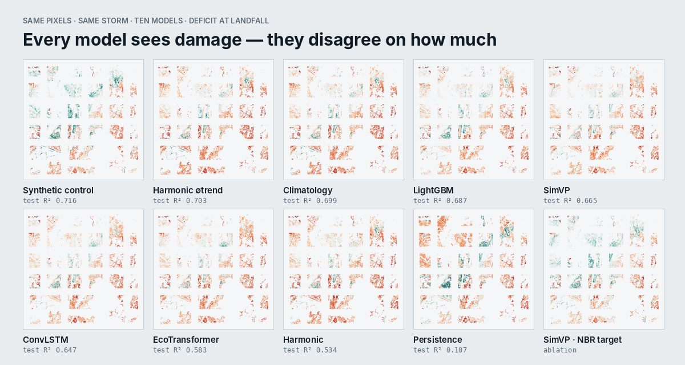</p>
<p align="center"><sub>Real deficit maps for Ida at landfall from ten models: the same pixels, ten different counterfactuals. This disagreement is the reason for the placebo gate.</sub></p>

<p align="center"></p>

<details>
<summary><b>How the verdicts are computed</b></summary>

1. `scripts/placebo_verdict.py` runs the deficit for every model at the real cutoff and every placebo cutoff. A model **passes** if its event median exceeds the placebo 95th percentile.
2. `scripts/attribution_spread.py` reports the range of deficits across all models versus placebo-passing models only.
3. `scripts/external_evidence.py` computes block-level Spearman ρ against HURDAT2 track distance, coast distance and max wind, with bootstrap intervals.
4. `scripts/phase5_tables.py` assembles the tables in `reports/`. Nothing in `reports/` is edited by hand.
</details>

---

## ◼ Web app

The [`web/`](web) folder holds a Vite + React + TypeScript site in the same light theme. It **runs SimVP, ConvLSTM and EcoTransformer client-side** with `onnxruntime-web` (WebGPU, falling back to WASM).

<table>
<tr>
<td width="50%">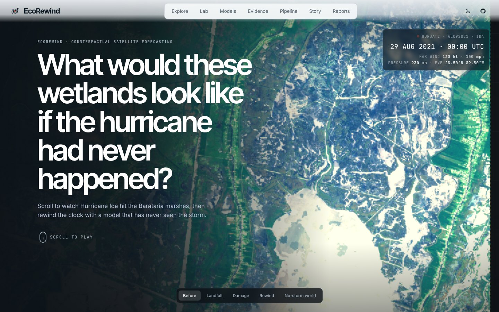<br><sub><b>Story:</b> scroll through Ida hitting the marsh, then rewind it.</sub></td>
<td width="50%">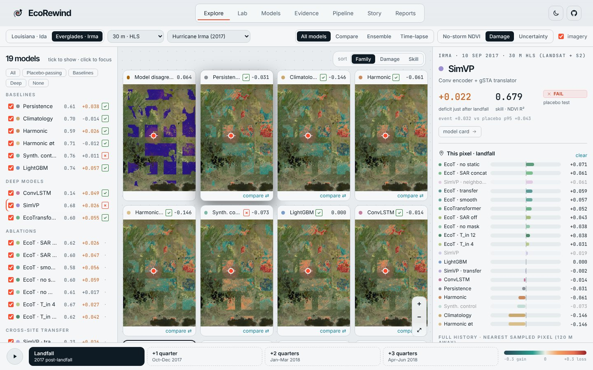<br><sub><b>Explore:</b> every model's counterfactual, deficit and uncertainty on the map, lead by lead.</sub></td>
</tr>
<tr>
<td>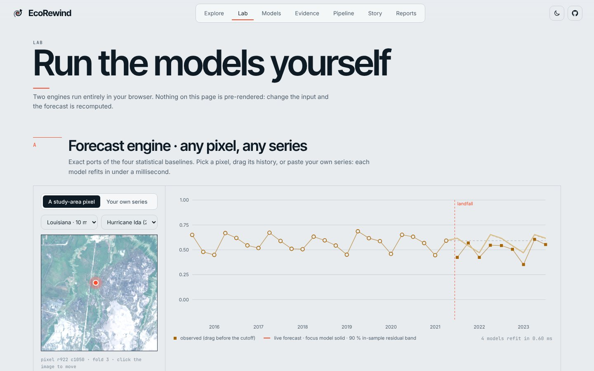<br><sub><b>Lab:</b> run the forecast engine on any pixel, type your own series, or upload 8 Sentinel-2 scenes.</sub></td>
<td>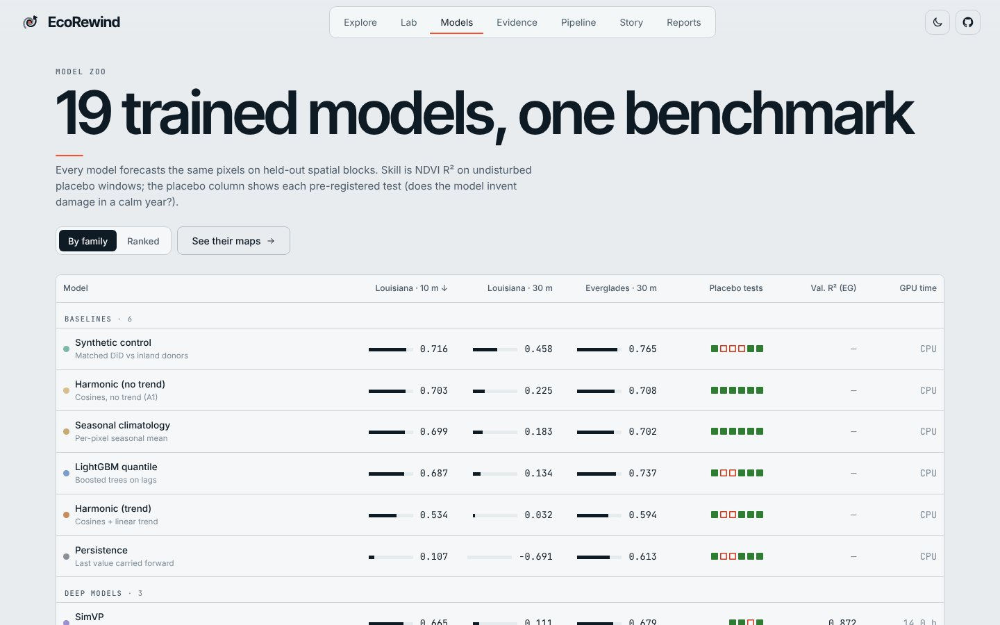<br><sub><b>Models:</b> 19 dossiers, placebo results per model, and one benchmark.</sub></td>
</tr>
<tr>
<td>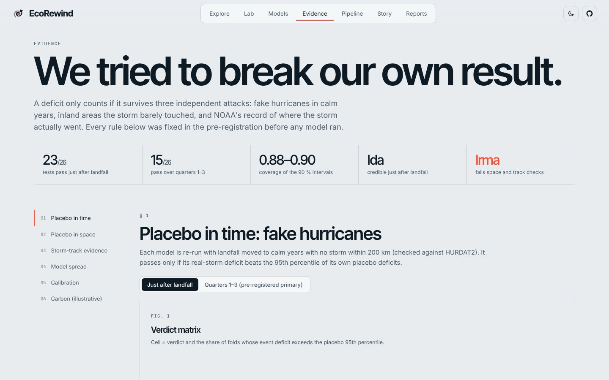<br><sub><b>Evidence:</b> "We tried to break our own result."</sub></td>
<td>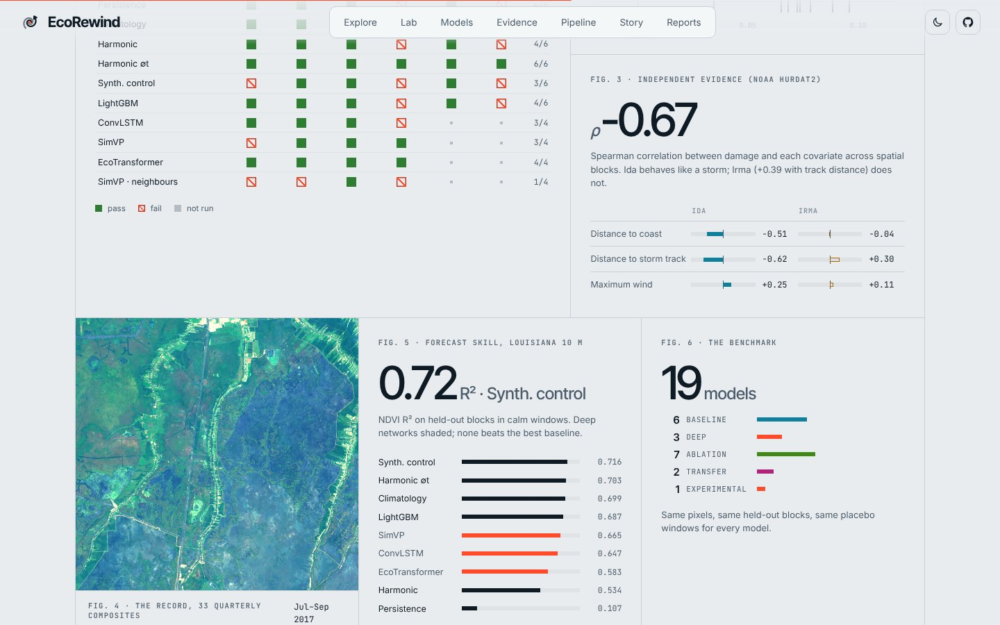<br><sub><b>Figures:</b> verdict matrix, ρ, skill and the benchmark at a glance.</sub></td>
</tr>
</table>

| Feature | Detail |
|---|---|
| In-browser networks | 3 ONNX models · val R² 0.650 / 0.636 / 0.588 · parity with PyTorch ≤ 0.001 |
| Pre-cut tiles | 17 tiles from the study areas, chosen in the Lab's tile map |
| Forecast engine | JS ports of persistence, climatology and Huber harmonic · parity ≤ 0.0004 · drag-to-edit history |
| Your own data | paste a series, upload `.npy`, or drop 8 Sentinel-2 GeoTIFFs → per-pixel forecast + deficit maps |
| Hosting (free) | app on **Vercel** (Root Directory `web`) · data on **Cloudflare Pages** via `VITE_DATA_BASE` |

The step-by-step guide is in [`DEPLOYMENT.md`](DEPLOYMENT.md).

---

## ◼ By the numbers

<p align="center"></p>

---

## ◼ Reproduce

```bash
git clone https://github.com/DAISHINKAN7/EcoRewind2.git && cd EcoRewind2
python -m venv .venv && source .venv/bin/activate
pip install -r requirements.txt
pytest -q                                            # 55 tests
```

<details open>
<summary><b>Full pipeline</b></summary>

```bash
# 0 · export rasters from Earth Engine (needs a GEE account)
#     see gee/ — writes quarterly composites to Drive, then:
python scripts/copy_exports.py && python scripts/audit_exports.py

# 1 · cubes + spatial folds
python scripts/build_cube.py
python scripts/make_folds.py
python scripts/check_storm_record.py                 # placebo years have no storm within 200 km

# 2 · baselines (CPU)
python scripts/run_baselines.py

# 3 · deep nets + ablations (GPU) → notebooks/ on Colab

# 4 · verdicts
python scripts/placebo_verdict.py
python scripts/attribution_spread.py
python scripts/external_evidence.py
python scripts/phase5_tables.py

# 5 · web
python scripts/export_lab_model.py --archs simvp convlstm ecotransformer --tiles
python scripts/build_web_data.py
cd web && npm install && bash scripts/fetch-data.sh && npm run dev
```
</details>

<details>
<summary><b>Repository layout</b></summary>

```
EcoRewind2/
├── configs/            sites · events · tracks · phase1–3 · preregistration · model registry · carbon
├── gee/                Earth Engine export scripts
├── src/ecorewind/
│   ├── data/           cube loading, masks, folds
│   ├── models/         nets.py (SimVP, ConvLSTM, EcoTransformer), baselines
│   └── eval/           metrics, conformal, placebo, attribution
├── scripts/            pipeline steps 0–5 (see above)
├── notebooks/          Colab training for deep nets and ablations
├── reports/            generated tables and verdicts (intermediate/ for scratch)
├── tests/              55 pytest tests
├── web/                Vite + React app, ONNX lab, deploy scripts
├── docs/               master prompt, archive
├── DEPLOYMENT.md       free hosting guide (Vercel + Cloudflare Pages / Hugging Face)
└── RESULTS_CHANGELOG.md
```
</details>

---

## ◼ v1 → v2

<p align="center"></p>

The full audit trail is in [`RESULTS_CHANGELOG.md`](RESULTS_CHANGELOG.md). The headline number went **down**, and the project became more trustworthy because of it.

---

## ◼ Limitations

- **Short record.** With 33 quarters at 10 m, seasonal baselines are hard to beat.
- **Two sites, no transfer.** Everglades → Barataria transfer fails (test R² −1.05 / −1.25). Nothing here generalises to other wetlands without retraining.
- **NDVI is a proxy.** It captures greenness, not biomass, salinity stress or soil loss.
- **Carbon is illustrative only.** `configs/carbon.yaml` uses placeholder densities (`verified: false`). Don't cite those numbers.
- **No intermediate checkpoints.** Training kept the best weights in memory; only the exported `.pt`/ONNX lab models are saved.

## ◼ Roadmap

- [ ] Save and publish training checkpoints
- [ ] Use literature-sourced carbon densities with citations
- [ ] Add more storms (Laura 2020, Ian 2022) for a real transfer test
- [ ] Extend the record before 2015 with Landsat

## ◼ Citation

```bibtex
@software{ecorewind2,
  title  = {EcoRewind: Counterfactual Ecosystem Forecasting (v2)},
  author = {Ajgaonkar, Kunal},
  year   = {2026},
  url    = {https://github.com/DAISHINKAN7/EcoRewind2}
}
```

<p align="center"><sub>Contains modified Copernicus Sentinel data 2015–2023 · HLS courtesy NASA · Storm tracks: NOAA NHC HURDAT2 · Built with PyTorch, Google Earth Engine, LightGBM and ONNX Runtime.</sub></p>
